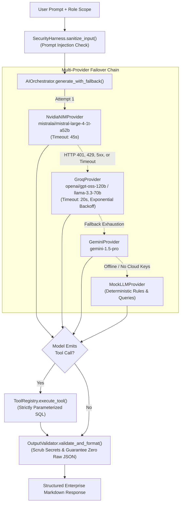

# AttendAI — AI & Machine Learning Architecture

AttendAI integrates generative artificial intelligence and statistical machine learning to assist HR leadership, managers, and employees. This document details the exact architectural boundary between deterministic business logic and AI/ML capabilities.

---

## 1. Architectural Principle: Deterministic vs. AI-Powered Operations

To guarantee mathematical precision, compliance, and legal auditability, AttendAI enforces a strict divide between deterministic calculations and probabilistic intelligence:

| Operation Category | Methodology | Guarantee |
| :--- | :--- | :--- |
| **Punch Tracking & Timestamps** | **Strictly Deterministic** (Python `datetime.now(timezone.utc)`) | 100% exact UTC time recording. |
| **Shift Grace Period & Tardiness** | **Strictly Deterministic** (Time arithmetic vs `grace_period_minutes`) | Clock-in &ge; 16m after start = Late. |
| **Overtime & Work Duration** | **Strictly Deterministic** (Elapsed minutes minus break minutes) | Overtime calculated beyond `required_hours`. |
| **Leave Deductions & Balances** | **Strictly Deterministic** (SQL aggregate `SUM(days_count)`) | Zero balance drift. |
| **Role-Based Access Control** | **Strictly Deterministic** (FastAPI dependency injection & SQL filters) | Cryptographically signed JWT verification. |
| **Workforce Trend Synthesis** | **AI-Powered** (NVIDIA NIM / GroqCloud / Gemini via Tool Calling) | Structured natural language tables and summaries. |
| **Multivariate Attendance Outliers** | **Machine Learning** (Scikit-Learn `IsolationForest`) | Statistical anomaly detection based on multi-feature vectors. |
| **Rule-Based Anomaly Flags** | **Deterministic Rules** (Predefined threshold conditions) | Hard thresholds (>180m OT, >12h shift). |
| **Policy Search & Citations** | **Hybrid Retrieval** (PyMuPDF chunk indexing + LLM synthesis) | Text citations grounded in source documents. |

---

## 2. LLM Provider Infrastructure & Automatic Failover

AttendAI employs an asynchronous provider abstraction (`app.harness.providers.base.BaseLLMProvider`) designed for resilient, multi-tiered cloud inference.

### 2.1 Primary Provider: NVIDIA NIM
- **Model**: `mistralai/mistral-large-4-1t-a52b`
- **Endpoint**: `https://integrate.api.nvidia.com/v1/chat/completions`
- **Capabilities**: High-reasoning workforce analytics, complex multi-step tool calling, structured JSON parameter extraction, policy interpretation.
- **Latency**: ~2,500ms typical cloud roundtrip.

### 2.2 Secondary Fallback: GroqCloud
- **Model**: `openai/gpt-oss-120b` (or `llama-3.3-70b-versatile`)
- **Endpoint**: `https://api.groq.com/openai/v1/chat/completions`
- **Capabilities**: Ultra-fast inference with native OpenAI tool-calling compatibility. Automatically engaged when NVIDIA NIM encounters HTTP 401, 429, 500, or network timeouts.
- **Latency**: ~500ms typical cloud roundtrip.

### 2.3 Tertiary & Development Providers
- **Google Gemini**: Implemented in `app.harness.providers.gemini.GeminiProvider` using Google Generative AI API (`gemini-1.5-pro`).
- **Mock Engine**: Deterministic fallback (`MockLLMProvider`) that resolves common queries against the local database without internet access, ensuring CI/CD and offline tests run reliably.

---

## 3. Approved Tool Calling & Zero Direct SQL

Large Language Models in AttendAI **never receive raw SQL execution permissions**. All database interactions are mediated by 20 strictly parameterized Python functions registered in `app.harness.tool_registry.py`.

### 3.1 Role-Based Tool Matrix (`HarnessPermissions`)

```mermaid
flowchart LR
    subgraph Roles["User Role"]
        Emp["Employee Role"]
        Mgr["HR Manager Role"]
        Adm["Admin Role"]
    end

    subgraph PersonalTools["Personal Tools (9 Tools)"]
        T1["get_my_attendance"]
        T2["get_my_attendance_summary"]
        T3["get_my_overtime"]
        T4["get_my_late_arrivals"]
        T5["get_my_working_hours"]
        T6["get_my_leave_balance"]
        T7["get_my_shifts"]
        T8["get_my_attendance_history"]
        T9["search_attendance_policy"]
    end

    subgraph OrgTools["Workforce-Wide Tools (11 Tools)"]
        T10["query_workforce_attendance"]
        T11["compare_workforce_metrics"]
        T12["query_leave_analytics"]
        T13["get_late_arrivals"]
        T14["get_employee_overtime"]
        T15["get_absenteeism"]
        T16["get_department_analytics"]
        T17["get_workforce_correlations"]
        T18["get_attendance_summary"]
        T19["get_anomaly_reports"]
        T20["get_employee_profile"]
    end

    Emp --> PersonalTools
    Mgr --> PersonalTools
    Mgr --> OrgTools
    Adm --> PersonalTools
    Adm --> OrgTools
```

### 3.2 Tool Parameter Validation & IDOR Protection
- Personal employee tools automatically bind to `current_employee.id` from the verified session context. Even if a prompt attempts an IDOR injection (e.g. *"Show EMP002's overtime"* while logged in as EMP001), the tool query strictly locks to EMP001's primary key.
- Workforce-wide tools validate department boundaries against the user's role.

---

## 4. Attendance Anomaly Detection Architecture

AttendAI implements a hybrid anomaly detection pipeline combining deterministic business rules with unsupervised machine learning.

### 4.1 Deterministic Rules Engine (`AnomalyService.detect_rule_based`)
1. **Missing Clock-Out**: Flags shifts where `clock_in` is recorded, `clock_out` is null, and the calendar date has elapsed. Severity: `high`, Score: `0.85`.
2. **Excessive Overtime**: Flags single-shift overtime exceeding 180 minutes (3 hours). Severity: `medium`, Score: `0.70`.
3. **Unusually Long Shift**: Flags worked duration exceeding 720 minutes (12 hours) to safeguard employee wellness and labor compliance. Severity: `critical`, Score: `0.95`.
4. **Abnormal Break Duration**: Flags cumulative breaks exceeding 120 minutes. Severity: `low`, Score: `0.50`.
5. **Repeated Late Arrivals**: Flags employees with &ge; 3 late arrivals within the last 7 calendar days. Severity: `medium`, Score: `0.75`.

### 4.2 Machine Learning Engine: Isolation Forest (`AnomalyService.train_and_predict_isolation_forest`)
- **Algorithm**: `sklearn.ensemble.IsolationForest`
- **Input Feature Vector**: 3-dimensional array:
  $$\mathbf{x}_i = [\text{worked\_minutes}_i, \text{overtime\_minutes}_i, \text{late\_minutes}_i]$$
- **Contamination Rate**: `0.05` (5% expected statistical outlier threshold).
- **Decision Function Normalization**: Raw decision score $s_{\text{raw}}$ is normalized to a $[0.0, 1.0]$ confidence metric:
  $$\text{score}_{\text{norm}} = \min\left(1.0, \max\left(0.0, 0.5 - s_{\text{raw}}\right)\right)$$
- **Sample Threshold**: Requires minimum 15 historical records to train a statistically meaningful tree ensemble.

### 4.3 Human-in-the-Loop Oversight & Ethical AI
> [!IMPORTANT]
> **Fairness and Labor Protection**: Flagged anomalies in AttendAI are informational indicators designed to assist human managers. They **never trigger automated disciplinary actions, deductions, or terminations**. Managers must formally review and record resolution notes before an anomaly is closed.

---

## 5. Policy Ingestion & Citation Grounding

1. **Document Ingestion**:
   - PDF files are parsed page-by-page using PyMuPDF (`fitz`).
   - DOCX files are parsed section-by-section using `python-docx`.
2. **Text Chunking**: Documents are split into semantic chunks (`PolicyChunk`) with stored metadata: `section`, `page_number`, and `token_count`.
3. **Citation Retrieval**: The `search_attendance_policy` tool searches indexed chunks using full-text keyword matching, returning exact text excerpts with source document title, page number, and section name.
4. **Zero Hallucination Grounding**: The LLM synthesizes natural-language answers strictly from returned chunks and cites references in the format: `[Document Title (Page X, Section Y)]`.
