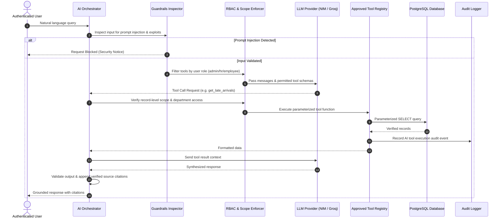

# AttendAI — AI Execution Harness & Security Architecture

The AttendAI AI Harness serves as a security boundary between user queries, large language models, and backend databases.

---

## 1. Tool Execution Sequence

---

## 2. Approved Tool Registry

| Tool Name | Permitted Roles | Purpose | Data Boundary |
|---|---|---|---|
| `get_my_attendance` | Admin, HR, Employee | Retrieve personal verified attendance history | Strictly current user profile |
| `get_attendance_summary` | Admin, HR Manager | Aggregated headcount & rate metrics | Organization or department |
| `get_late_arrivals` | Admin, HR Manager | Query employees arriving past grace window | Organization-wide |
| `get_employee_overtime` | Admin, HR Manager | Summarize overtime hours over rolling period | Organization-wide |
| `get_department_analytics` | Admin, HR Manager | Compare attendance across departments | Organization-wide |
| `search_attendance_policy` | Admin, HR, Employee | Semantic / full-text policy chunk retrieval | All indexed documents |
| `get_anomaly_reports` | Admin, HR Manager | Fetch anomaly flags for investigation | Pending / investigating |
| `get_employee_profile` | Admin, HR Manager | Directory information lookup | Organization |

---

## 3. Threat Mitigation Controls

1. **No Direct SQL**: The LLM cannot write or execute raw SQL. All data retrieval goes through strictly typed, parameterized Python functions.
2. **Prompt Injection Resistance**: Pre-execution regex and pattern filters detect attempts to override system prompts or dump credentials.
3. **Data Leakage Redaction**: Output validator filters prevent accidental echoing of JWT tokens, API keys, or raw hashes.
4. **Untrusted Context Isolation**: Retrieved policy chunks are labeled as untrusted context, preventing document-based instruction hijacks.
