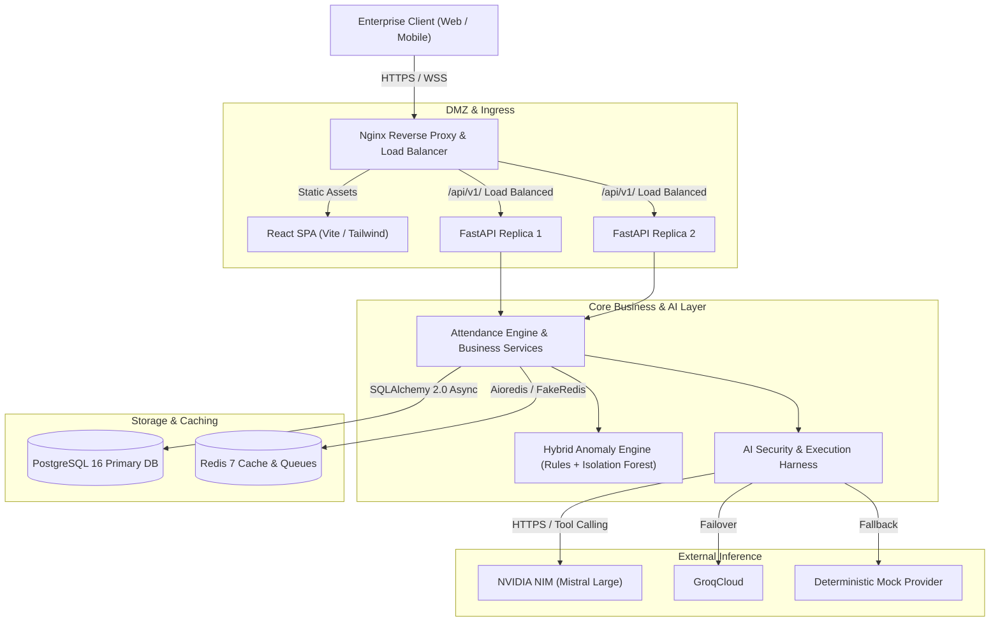
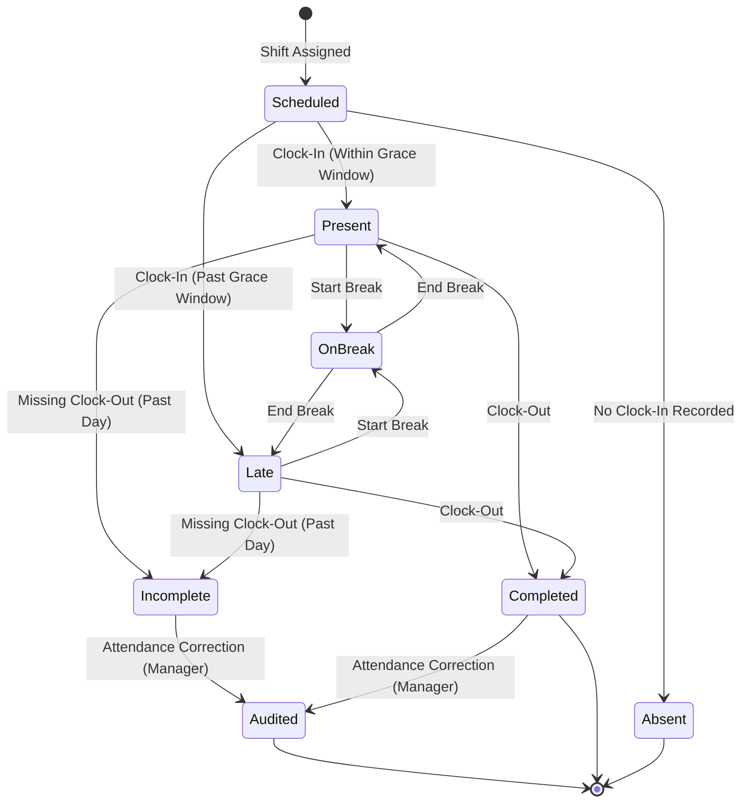

# AttendAI — System Architecture

AttendAI is an enterprise-grade AI-powered workforce time-and-attendance platform engineered for high accuracy, deterministic compliance, and secure conversational intelligence.

---

## 1. High-Level Architecture Diagram

---

## 2. Attendance Lifecycle State Diagram

---

## 3. High Availability vs Load Balancing

> [!NOTE]
> **Load Balancing vs High Availability**:
> The Nginx load balancer distributes HTTP requests across multiple stateless FastAPI backend replicas using the `least_conn` strategy. However, database high availability requires PostgreSQL replication (such as Patroni or AWS Aurora Multi-AZ) with automated failover. Running a single PostgreSQL container provides local persistence, not database fault tolerance.
