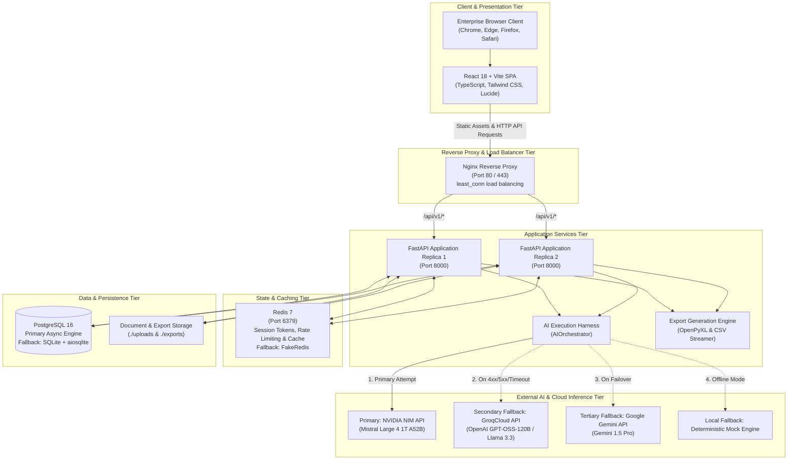
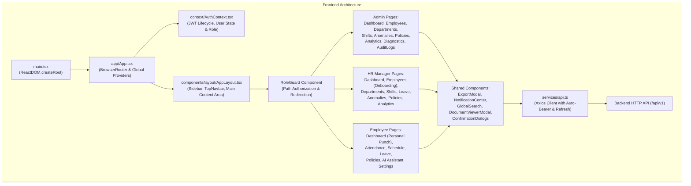
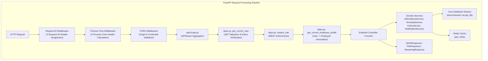
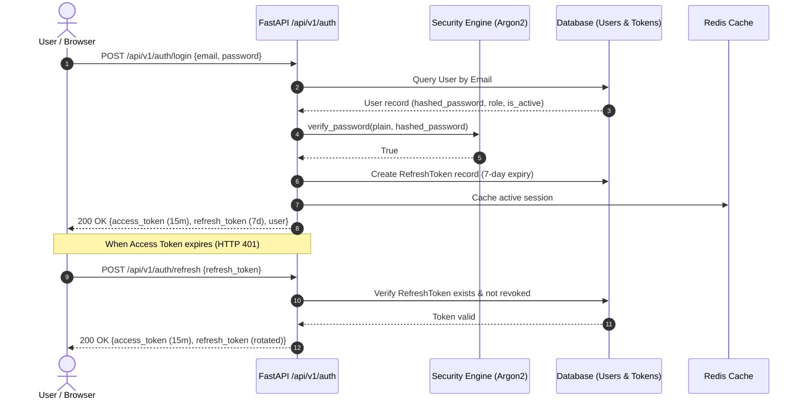
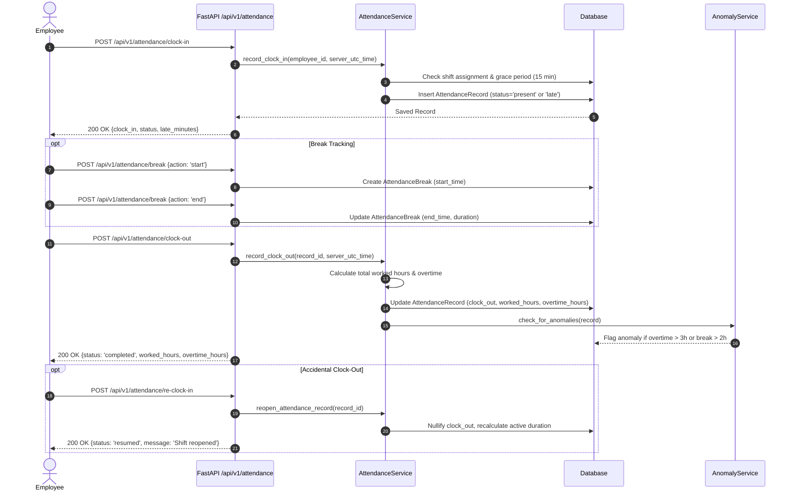
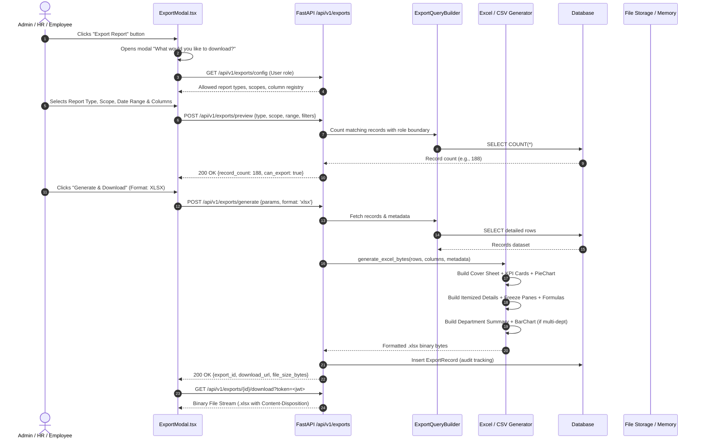
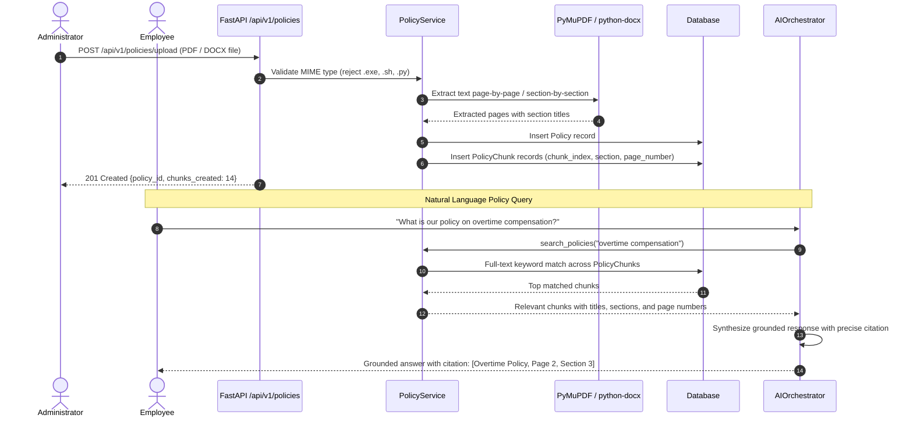

# AttendAI — System Architecture & Component Interaction

AttendAI is an enterprise workforce time-and-attendance management platform engineered with an asynchronous backend, a role-tailored React frontend, deterministic attendance rules, an Isolation Forest machine learning anomaly engine, and an AI execution harness backed by NVIDIA NIM and GroqCloud.

---

## 1. High-Level Architecture Overview

---

## 2. Frontend Architecture

The frontend is a single-page application (SPA) built on React 18, TypeScript, and Vite. It emphasizes a Dayforce-grade corporate user experience, responsive typography, and silent role-based access control.

### Key Frontend Components
- **`AuthContext.tsx`**: Manages user authentication state, access tokens, refresh token rotation, and decoded RBAC roles (`admin`, `hr_manager`, `employee`).
- **`AppLayout.tsx`**: Renders the persistent Dayforce-inspired navigation bar, unread notification bell popover, global search bar (`Cmd/Ctrl + K`), and role-scoped sidebar navigation.
- **`RoleGuard.tsx`**: Route protection wrapper that prevents unauthorized URL navigation by redirecting prohibited roles directly to `/403` (Forbidden).
- **`ExportModal.tsx`**: Multi-step report builder dialog (*"What would you like to download?"*) preventing immediate file downloads and allowing users to select report types, scope, date ranges, columns, and formats (CSV / XLSX).
- **`DocumentViewerModal.tsx`**: In-browser document viewer supporting native multi-page PDF rendering (page navigation, zoom) and structured DOCX rendering.

---

## 3. Backend Architecture

The backend is built with FastAPI (Python 3.12+), utilizing asynchronous request handling (`async`/`await`), dependency injection, and declarative Pydantic v2 schemas.

### Middleware Pipeline
1. **`logging_and_request_id_middleware`**: Injects a unique UUIDv4 into `request.state.request_id`, tracks total execution time in milliseconds, logs inbound requests, and attaches `X-Request-ID` and `X-Process-Time` response headers.
2. **`CORSMiddleware`**: Configures authorized client origins (`http://localhost:3000`, `http://localhost:5173`, etc.) and allows credentials, headers, and HTTP methods.
3. **`Exception Handlers`**: Intercepts `AttendAIException` (structured domain errors) and unhandled Python exceptions, returning sanitized JSON payloads with the active `request_id`.

---

## 4. Database Architecture & Multi-Tenancy

AttendAI implements an organization-based data isolation model:
- Every tenant entity links directly to `Organization.id`.
- Users and employees belong to an organization and a department.
- SQLAlchemy 2.0 Async ORM handles connection pooling and queries.
- Primary production engine: **PostgreSQL 16** via `asyncpg`.
- Fallback development engine: **SQLite** via `aiosqlite` with `check_same_thread=False`.

---

## 5. Core Workflows

### 5.1 Authentication & Token Refresh Workflow

### 5.2 Attendance & Punch Lifecycle Workflow

### 5.3 Custom Report Generation Workflow

### 5.4 Document Ingestion & Citation Retrieval Workflow

---

## 6. Infrastructure & Deployment Topology

In containerized production deployments via `docker-compose.yml`:
- **Nginx Reverse Proxy**: Listens on ports 80/8000, proxies static UI requests to the `frontend` container, and balances API requests between `backend_1` and `backend_2` using the `least_conn` load balancing algorithm.
- **FastAPI Cluster**: Two identical stateless backend instances with Gunicorn/Uvicorn workers.
- **Database & Cache**: Dedicated PostgreSQL 16 and Redis 7 containers configured with healthchecks, persistent Docker volumes, and container isolation.
