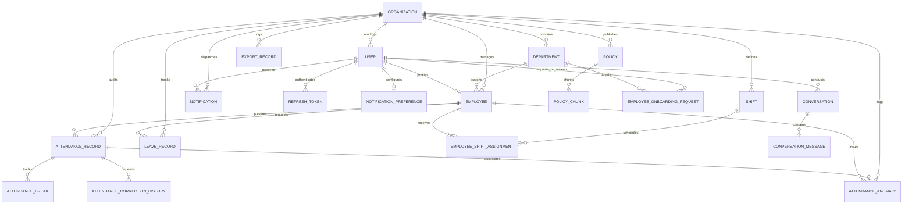

# AttendAI — Database Schema & Data Architecture

AttendAI utilizes an asynchronous database engine configured through SQLAlchemy 2.0. The schema is organized around a multi-tenant hierarchy where all operational records isolate cleanly under an `Organization`.

---

## 1. Entity-Relationship (ER) Diagram



---

## 2. Table Specifications

### 2.1 Core Multi-Tenant Hierarchy

#### `organizations`
Represents the top-level corporate tenant boundary.
| Column | Type | Nullable | Default | Description |
| :--- | :--- | :--- | :--- | :--- |
| `id` | `VARCHAR(36)` | No | `UUIDv4` | Primary Key |
| `name` | `VARCHAR(255)` | No | — | Unique corporate name |
| `timezone` | `VARCHAR(50)` | No | `'UTC'` | Operating timezone |
| `created_at` | `DATETIME` | No | `utcnow` | Creation timestamp |
| `updated_at` | `DATETIME` | No | `utcnow` | Last update timestamp |

#### `departments`
Workforce subdivisions within an organization.
| Column | Type | Nullable | Default | Description |
| :--- | :--- | :--- | :--- | :--- |
| `id` | `VARCHAR(36)` | No | `UUIDv4` | Primary Key |
| `organization_id` | `VARCHAR(36)` | No | — | FK to `organizations.id` (CASCADE) |
| `name` | `VARCHAR(100)` | No | — | Department title (e.g., Engineering, HR) |
| `code` | `VARCHAR(20)` | No | — | Short identifier (e.g., ENG, HR) |
| `manager_id` | `VARCHAR(36)` | Yes | `NULL` | Optional Department Manager user ID |
| `created_at` | `DATETIME` | No | `utcnow` | Creation timestamp |
| `updated_at` | `DATETIME` | No | `utcnow` | Last update timestamp |
*Constraints*: `UniqueConstraint("organization_id", "code")`

---

### 2.2 Identity & Workforce Profiles

#### `users`
System authentication credentials and global RBAC role assignments.
| Column | Type | Nullable | Default | Description |
| :--- | :--- | :--- | :--- | :--- |
| `id` | `VARCHAR(36)` | No | `UUIDv4` | Primary Key |
| `organization_id` | `VARCHAR(36)` | No | — | FK to `organizations.id` (CASCADE) |
| `email` | `VARCHAR(255)` | No | — | Unique corporate email (Indexed) |
| `hashed_password` | `VARCHAR(255)` | No | — | Argon2 password hash |
| `role` | `VARCHAR(50)` | No | `'employee'` | RBAC Role (`admin`, `hr_manager`, `employee`) |
| `is_active` | `BOOLEAN` | No | `True` | Account operational status |
| `created_at` | `DATETIME` | No | `utcnow` | Account creation timestamp |
| `updated_at` | `DATETIME` | No | `utcnow` | Account update timestamp |

#### `employees`
HR workforce profile associated with a user account.
| Column | Type | Nullable | Default | Description |
| :--- | :--- | :--- | :--- | :--- |
| `id` | `VARCHAR(36)` | No | `UUIDv4` | Primary Key |
| `organization_id` | `VARCHAR(36)` | No | — | FK to `organizations.id` (CASCADE) |
| `department_id` | `VARCHAR(36)` | Yes | `NULL` | FK to `departments.id` (SET NULL) |
| `user_id` | `VARCHAR(36)` | Yes | `NULL` | FK to `users.id` (CASCADE, Unique) |
| `employee_code` | `VARCHAR(50)` | No | — | Unique employee identifier (e.g., EMP001) |
| `first_name` | `VARCHAR(100)` | No | — | Given name |
| `last_name` | `VARCHAR(100)` | No | — | Family name |
| `email` | `VARCHAR(255)` | No | — | Contact email |
| `phone` | `VARCHAR(30)` | Yes | `NULL` | Contact phone number |
| `designation` | `VARCHAR(100)` | No | — | Corporate job title |
| `date_of_joining` | `DATE` | No | — | Employment start date |
| `is_active` | `BOOLEAN` | No | `True` | Active employment status |
| `created_at` | `DATETIME` | No | `utcnow` | Record created timestamp |
| `updated_at` | `DATETIME` | No | `utcnow` | Record updated timestamp |
*Constraints*: `UniqueConstraint("organization_id", "employee_code")`

---

### 2.3 Scheduling & Shifts

#### `shifts`
Standard operating work schedules.
| Column | Type | Nullable | Default | Description |
| :--- | :--- | :--- | :--- | :--- |
| `id` | `VARCHAR(36)` | No | `UUIDv4` | Primary Key |
| `organization_id` | `VARCHAR(36)` | No | — | FK to `organizations.id` (CASCADE) |
| `name` | `VARCHAR(100)` | No | — | Shift name (e.g., General Shift) |
| `code` | `VARCHAR(30)` | No | — | Shift code (e.g., GEN, MOR, NOC) |
| `start_time` | `TIME` | No | — | Scheduled shift commencement |
| `end_time` | `TIME` | No | — | Scheduled shift completion |
| `grace_period_minutes` | `INTEGER` | No | `15` | Minutes allowed before tardiness |
| `required_hours` | `FLOAT` | No | `8.0` | Expected productive hours |
| `is_overnight` | `BOOLEAN` | No | `False` | True if shift crosses midnight |
| `created_at` | `DATETIME` | No | `utcnow` | Creation timestamp |
| `updated_at` | `DATETIME` | No | `utcnow` | Update timestamp |

#### `employee_shift_assignments`
Assigns schedules to employees across date horizons.
| Column | Type | Nullable | Default | Description |
| :--- | :--- | :--- | :--- | :--- |
| `id` | `VARCHAR(36)` | No | `UUIDv4` | Primary Key |
| `employee_id` | `VARCHAR(36)` | No | — | FK to `employees.id` (CASCADE) |
| `shift_id` | `VARCHAR(36)` | No | — | FK to `shifts.id` (CASCADE) |
| `effective_from` | `DATE` | No | — | Schedule active start date |
| `effective_to` | `DATE` | Yes | `NULL` | Optional expiry date |
| `is_active` | `BOOLEAN` | No | `True` | Active assignment flag |
| `created_at` | `DATETIME` | No | `utcnow` | Creation timestamp |

---

### 2.4 Time & Attendance Subsystem

#### `attendance_records`
Daily punch activity, calculated hours, and punctuality status.
| Column | Type | Nullable | Default | Description |
| :--- | :--- | :--- | :--- | :--- |
| `id` | `VARCHAR(36)` | No | `UUIDv4` | Primary Key |
| `organization_id` | `VARCHAR(36)` | No | — | FK to `organizations.id` (CASCADE) |
| `employee_id` | `VARCHAR(36)` | No | — | FK to `employees.id` (CASCADE) |
| `date` | `DATE` | No | — | Attendance calendar date (Indexed) |
| `clock_in` | `DATETIME` | Yes | `NULL` | UTC clock-in punch timestamp |
| `clock_out` | `DATETIME` | Yes | `NULL` | UTC clock-out punch timestamp |
| `worked_minutes` | `INTEGER` | No | `0` | Net productive minutes |
| `overtime_minutes` | `INTEGER` | No | `0` | Overtime minutes beyond shift |
| `late_minutes` | `INTEGER` | No | `0` | Minutes arrived after grace period |
| `status` | `VARCHAR(30)` | No | `'present'` | `present`, `late`, `half_day`, `absent`, `incomplete` |
| `is_corrected` | `BOOLEAN` | No | `False` | True if manual adjustment applied |
| `created_at` | `DATETIME` | No | `utcnow` | Record creation timestamp |
| `updated_at` | `DATETIME` | No | `utcnow` | Record update timestamp |
*Constraints*: `UniqueConstraint("employee_id", "date")`, `Index("idx_attendance_org_date", "organization_id", "date")`

#### `attendance_breaks`
Intermittent breaks logged during an active shift.
| Column | Type | Nullable | Default | Description |
| :--- | :--- | :--- | :--- | :--- |
| `id` | `VARCHAR(36)` | No | `UUIDv4` | Primary Key |
| `attendance_record_id` | `VARCHAR(36)` | No | — | FK to `attendance_records.id` (CASCADE) |
| `break_start` | `DATETIME` | No | — | UTC break commencement |
| `break_end` | `DATETIME` | Yes | `NULL` | UTC break resumption |
| `duration_minutes` | `INTEGER` | No | `0` | Computed break duration |
| `reason` | `VARCHAR(255)` | Yes | `NULL` | Lunch, Personal, Medical, etc. |
| `created_at` | `DATETIME` | No | `utcnow` | Record timestamp |

#### `attendance_correction_history`
Audit ledger of manual punch amendments.
| Column | Type | Nullable | Default | Description |
| :--- | :--- | :--- | :--- | :--- |
| `id` | `VARCHAR(36)` | No | `UUIDv4` | Primary Key |
| `attendance_record_id` | `VARCHAR(36)` | No | — | FK to `attendance_records.id` (CASCADE) |
| `corrected_by` | `VARCHAR(36)` | No | — | User ID of manager applying correction |
| `previous_clock_in` | `DATETIME` | Yes | `NULL` | Original clock-in value |
| `new_clock_in` | `DATETIME` | Yes | `NULL` | Adjusted clock-in value |
| `previous_clock_out` | `DATETIME` | Yes | `NULL` | Original clock-out value |
| `new_clock_out` | `DATETIME` | Yes | `NULL` | Adjusted clock-out value |
| `reason` | `TEXT` | No | — | Mandatory audit rationale |
| `created_at` | `DATETIME` | No | `utcnow` | Timestamp of correction |

---

### 2.5 Leave & Anomalies

#### `leave_records`
Employee time-off requests and supervisor approval decisions.
| Column | Type | Nullable | Default | Description |
| :--- | :--- | :--- | :--- | :--- |
| `id` | `VARCHAR(36)` | No | `UUIDv4` | Primary Key |
| `organization_id` | `VARCHAR(36)` | No | — | FK to `organizations.id` (CASCADE) |
| `employee_id` | `VARCHAR(36)` | No | — | FK to `employees.id` (CASCADE) |
| `leave_type` | `VARCHAR(50)` | No | — | `annual`, `sick`, `casual`, `unpaid` |
| `start_date` | `DATE` | No | — | First date of leave |
| `end_date` | `DATE` | No | — | Last date of leave |
| `days_count` | `FLOAT` | No | — | Working days requested |
| `reason` | `TEXT` | No | — | Application justification |
| `status` | `VARCHAR(30)` | No | `'pending'` | `pending`, `approved`, `rejected` |
| `reviewed_by` | `VARCHAR(36)` | Yes | `NULL` | User ID of reviewing manager |
| `reviewed_at` | `DATETIME` | Yes | `NULL` | Review timestamp |
| `resolution_notes` | `TEXT` | Yes | `NULL` | Manager remarks |
| `created_at` | `DATETIME` | No | `utcnow` | Submission timestamp |
| `updated_at` | `DATETIME` | No | `utcnow` | Decision timestamp |

#### `attendance_anomalies`
Statistical outliers and deterministic rule violations.
| Column | Type | Nullable | Default | Description |
| :--- | :--- | :--- | :--- | :--- |
| `id` | `VARCHAR(36)` | No | `UUIDv4` | Primary Key |
| `organization_id` | `VARCHAR(36)` | No | — | FK to `organizations.id` (CASCADE) |
| `employee_id` | `VARCHAR(36)` | No | — | FK to `employees.id` (CASCADE) |
| `attendance_record_id` | `VARCHAR(36)` | Yes | `NULL` | FK to `attendance_records.id` (SET NULL) |
| `date` | `DATE` | No | — | Incident calendar date (Indexed) |
| `anomaly_type` | `VARCHAR(100)` | No | — | `missing_punch`, `repeated_late`, `excessive_overtime`, `abnormal_break`, `isolation_forest` |
| `severity` | `VARCHAR(20)` | No | `'medium'` | `low`, `medium`, `high`, `critical` |
| `score` | `FLOAT` | No | `0.0` | ML outlier confidence score |
| `detection_method` | `VARCHAR(50)` | No | `'rule_based'` | `rule_based`, `isolation_forest`, `hybrid` |
| `explanation` | `TEXT` | No | — | Human-readable explanation |
| `status` | `VARCHAR(30)` | No | `'pending'` | `pending`, `investigating`, `resolved`, `dismissed` |
| `reviewed_by` | `VARCHAR(36)` | Yes | `NULL` | Manager who inspected anomaly |
| `reviewed_at` | `DATETIME` | Yes | `NULL` | Review timestamp |
| `resolution_notes` | `TEXT` | Yes | `NULL` | Resolution audit notes |
| `created_at` | `DATETIME` | No | `utcnow` | Detection timestamp |
| `updated_at` | `DATETIME` | No | `utcnow` | Status update timestamp |

---

### 2.6 Policies & Document Retrieval

#### `policies`
Uploaded policy documents.
| Column | Type | Nullable | Default | Description |
| :--- | :--- | :--- | :--- | :--- |
| `id` | `VARCHAR(36)` | No | `UUIDv4` | Primary Key |
| `organization_id` | `VARCHAR(36)` | No | — | FK to `organizations.id` (CASCADE) |
| `title` | `VARCHAR(255)` | No | — | Policy title |
| `category` | `VARCHAR(100)` | No | `'Attendance & Leave'` | Document category |
| `file_path` | `VARCHAR(500)` | Yes | `NULL` | Disk storage path |
| `file_size` | `INTEGER` | No | `0` | File size in bytes |
| `status` | `VARCHAR(30)` | No | `'active'` | `processing`, `active`, `failed` |
| `created_at` | `DATETIME` | No | `utcnow` | Upload timestamp |
| `updated_at` | `DATETIME` | No | `utcnow` | Last index timestamp |

#### `policy_chunks`
Extracted text passages indexed for citation retrieval.
| Column | Type | Nullable | Default | Description |
| :--- | :--- | :--- | :--- | :--- |
| `id` | `VARCHAR(36)` | No | `UUIDv4` | Primary Key |
| `policy_id` | `VARCHAR(36)` | No | — | FK to `policies.id` (CASCADE) |
| `title` | `VARCHAR(255)` | No | — | Chunk header or section title |
| `section` | `VARCHAR(255)` | Yes | `NULL` | Document subsection name |
| `page_number` | `INTEGER` | No | `1` | Source document page number |
| `content` | `TEXT` | No | — | Extracted plaintext body |
| `token_count` | `INTEGER` | No | `0` | Approximate token volume |
| `created_at` | `DATETIME` | No | `utcnow` | Ingestion timestamp |
*Indexes*: `Index("idx_policy_chunk_content", "policy_id")`

---

### 2.7 AI Conversations & Notifications

#### `conversations` & `conversation_messages`
Stores multi-turn AI chat threads, tool invocations, and policy citations.
- `conversations`: `id`, `organization_id`, `user_id`, `title`, `created_at`, `updated_at`.
- `conversation_messages`: `id`, `conversation_id`, `role` (`user`, `assistant`, `system`, `tool`), `content`, `tool_calls` (JSON), `tool_results` (JSON), `citations` (JSON), `created_at`.

#### `notifications` & `notification_preferences`
Database-backed event notifications and personal delivery toggles.
- `notifications`: `id`, `organization_id`, `user_id` (Indexed), `title`, `message`, `category` (10 categories), `priority` (`critical`, `warning`, `success`, `information`), `link`, `is_read`, `is_archived`, `metadata_json`, `created_at`.
- `notification_preferences`: `id`, `user_id` (Unique), `email_enabled`, `in_app_enabled`, `categories` (JSON), `created_at`, `updated_at`.

---

### 2.8 Onboarding & Custom Exports

#### `employee_onboarding_requests`
Two-stage onboarding workflow where HR submits an employee addition and Admin reviews/authorizes.
| Column | Type | Nullable | Default | Description |
| :--- | :--- | :--- | :--- | :--- |
| `id` | `VARCHAR(36)` | No | `UUIDv4` | Primary Key |
| `organization_id` | `VARCHAR(36)` | No | — | FK to `organizations.id` (CASCADE) |
| `requested_by_id` | `VARCHAR(36)` | Yes | `NULL` | FK to `users.id` (HR submitter) |
| `employee_code` | `VARCHAR(50)` | No | — | Proposed code |
| `first_name` | `VARCHAR(100)` | No | — | First name |
| `last_name` | `VARCHAR(100)` | No | — | Last name |
| `email` | `VARCHAR(255)` | No | — | Email address |
| `phone` | `VARCHAR(50)` | Yes | `NULL` | Phone number |
| `department_id` | `VARCHAR(36)` | Yes | `NULL` | Target department |
| `designation` | `VARCHAR(100)` | Yes | `NULL` | Job title |
| `date_of_joining` | `DATE` | No | `today` | Start date |
| `role` | `VARCHAR(50)` | No | `'employee'` | Assigned user role |
| `status` | `VARCHAR(50)` | No | `'pending_approval'` | `pending_approval`, `approved`, `rejected` |
| `reviewed_by_id` | `VARCHAR(36)` | Yes | `NULL` | Admin reviewer user ID |
| `reviewed_at` | `DATETIME` | Yes | `NULL` | Review timestamp |
| `rejection_reason` | `TEXT` | Yes | `NULL` | Rejection comments |
| `created_at` | `DATETIME` | No | `utcnow` | Submission timestamp |
| `updated_at` | `DATETIME` | No | `utcnow` | Review timestamp |

#### `export_records`
Persistent audit log of generated custom reports.
| Column | Type | Nullable | Default | Description |
| :--- | :--- | :--- | :--- | :--- |
| `id` | `VARCHAR(36)` | No | `UUIDv4` | Primary Key |
| `organization_id` | `VARCHAR(36)` | No | — | FK to `organizations.id` (CASCADE) |
| `user_id` | `VARCHAR(36)` | No | — | FK to `users.id` (CASCADE) |
| `role` | `VARCHAR(50)` | No | — | Role of generator |
| `report_name` | `VARCHAR(255)` | No | — | Human-readable title |
| `report_type` | `VARCHAR(100)` | No | — | Specific report type key |
| `scope_type` | `VARCHAR(50)` | No | — | `organization`, `department`, `employee`, `personal` |
| `scope_summary` | `TEXT` | Yes | `NULL` | Summary description of scope |
| `date_preset` | `VARCHAR(50)` | Yes | `NULL` | Date filter identifier |
| `start_date` | `DATE` | No | — | Filter start boundary |
| `end_date` | `DATE` | No | — | Filter end boundary |
| `format` | `VARCHAR(20)` | No | — | `csv` or `xlsx` |
| `columns_selected` | `JSON` | Yes | `NULL` | Array of included column IDs |
| `filters_applied` | `JSON` | Yes | `NULL` | Additional filter dictionary |
| `record_count` | `INTEGER` | No | `0` | Exported row count |
| `file_path` | `VARCHAR(500)` | Yes | `NULL` | Storage path on server |
| `file_size_bytes` | `INTEGER` | No | `0` | Size of generated file |
| `status` | `VARCHAR(50)` | No | `'completed'` | Status of export |
| `created_at` | `DATETIME` | No | `utcnow` | Generation timestamp |

---

## 3. Database Migration Procedures

Database schemas are managed using Alembic.
- **Generate a new migration**:
  ```bash
  alembic revision --autogenerate -m "add_new_feature_table"
  ```
- **Apply migrations to head**:
  ```bash
  alembic upgrade head
  ```
- **Revert last migration**:
  ```bash
  alembic downgrade -1
  ```
