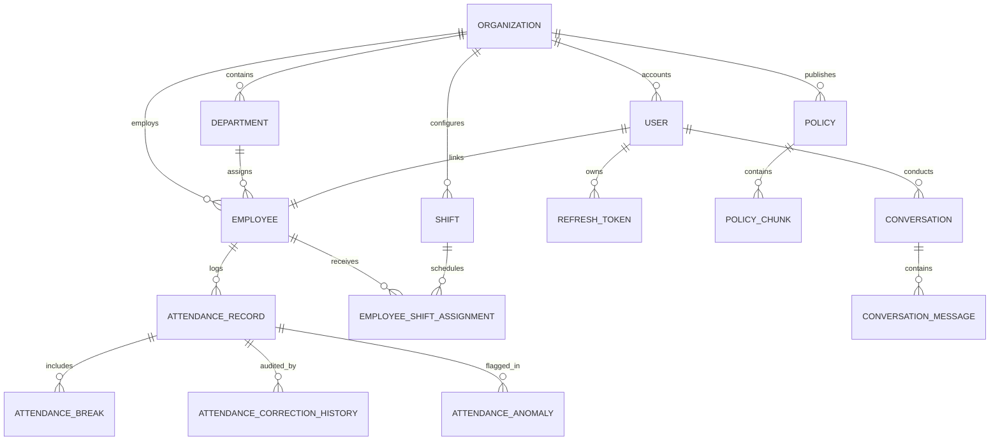

# Database Schema & Entity Relationships

AttendAI exclusively utilizes normalized relational storage in PostgreSQL with UUID primary keys, foreign key constraints, and specialized indexes.

---

## 1. Entity-Relationship Diagram

---

## 2. Table Specifications

1. **organizations**: Multi-tenant boundary, stores organization name, default timezone, and tenant metadata.
2. **departments**: Business units (Engineering, HR, etc.) with code, organization ID, and manager references.
3. **users**: Authentication credentials, Argon2 password hashes, role assignment (`admin`, `hr_manager`, `employee`), and activation flags.
4. **employees**: Demographic records, employee code, first/last name, work email, phone, date of joining.
5. **shifts**: Start time, end time, grace period minutes, required duration, and overnight cross-midnight indicators.
6. **employee_shift_assignments**: Effective date range mapping employees to active shifts.
7. **attendance_records**: Daily attendance records with clock-in/out timestamps, worked minutes, overtime, late arrival minutes, and status.
8. **attendance_breaks**: Granular break timestamps, cumulative duration, and audit reason.
9. **attendance_anomalies**: Investigation flags detected via deterministic rules or Isolation Forest multivariate analysis.
10. **policies & policy_chunks**: Document chunk storage with full-text search capability (`tsvector`, `ILIKE`).
11. **conversations & conversation_messages**: Chat threads, tool call invocations, tool results, and source citations.
12. **audit_logs**: Immutable record of security-sensitive operations, tool calls, and role changes.
