# AttendAI — Reporting, Analytics & Custom Export Architecture

AttendAI incorporates an enterprise-grade custom report builder and multi-format export engine. Clicking any **Export** button across the platform opens an interactive modal rather than triggering immediate raw downloads.

---

## 1. Custom Report Builder Workflow

```mermaid
flowchart TD
    Click["User Clicks 'Export' on any Page"] --> Modal["Custom Export Modal Opens:\n'What would you like to download?'"]
    
    subgraph Step1["Step 1: Document & Report Selection"]
        Modal --> SelectType["Role-Scoped Report Type Selection\n(Admin: 10 types | HR: 8 types | Employee: 7 types)"]
    end
    
    subgraph Step2["Step 2: Data Scope Configuration"]
        SelectType --> SelectScope["Data Scope Selection\n(Org-Wide | Department | Multi-Dept | Single Emp | Personal Locked)"]
    end
    
    subgraph Step3["Step 3: Date Horizon & Filters"]
        SelectScope --> SelectDates["Date Presets (Today, This Month, Last 30 Days)\nor Custom Date Range Picker"]
        SelectDates --> SelectFilters["Granular Filters (Status, Min Overtime, Min Late)"]
    end
    
    subgraph Step4["Step 4: Output Format Selection"]
        SelectFilters --> SelectFormat["Select Output Format:\n1. CSV (.csv)\n2. Formatted Excel (.xlsx)"]
    end
    
    subgraph Step5["Step 5: Column Customization"]
        SelectFormat --> SelectCols["Column Selection Registry\n(Select All / Restore Defaults)"]
    end
    
    subgraph Step6["Step 6: Live Preview & Generation"]
        SelectCols --> Preview["POST /api/v1/exports/preview\n(Calculates exact matching record count)"]
        Preview --> Confirm{"User Clicks\n'Generate & Download'"}
        Confirm --> Gen["POST /api/v1/exports/generate"]
        Gen --> FileStream["Download Formatted File Stream\nvia Authenticated URL"]
    end
```

---

## 2. Role-Based Report Catalog

### 2.1 Administrator (10 Report Types)
- **Complete Organization Report**: Comprehensive workforce attendance, working hours, and punctuality across all departments.
- **Department Report**: Focused audit of a single operating unit.
- **Multiple Department Report**: Comparative departmental workforce analysis.
- **Individual Employee Report**: Itemized daily punch ledger for a specific employee.
- **Multiple Employee Report**: Batch export of selected staff members.
- **Attendance Summary Report**: Aggregate metrics (present, absent, late, overtime).
- **Overtime Audit Report**: Shift-by-shift overtime tracking for payroll compliance.
- **Leave History Report**: Annual, sick, and casual time-off ledger.
- **Workforce Anomaly Report**: Statistical outliers and policy violations.
- **Workforce Analytics Report**: High-level KPI trends and attendance rates.

### 2.2 HR Manager (8 Report Types)
- **Authorized Department Report**: Scoped exclusively to assigned operating units.
- **Individual Employee Report**: Authorized staff punch history.
- **Multiple Employee Report**: Scoped team reports.
- **Attendance Report**: Departmental punctuality tracking.
- **Overtime Report**: Departmental overtime accruals.
- **Leave Report**: Team leave balances and approvals.
- **Shift Report**: Departmental shift roster assignments.
- **Anomaly Report**: Departmental tardiness and break flags.

### 2.3 Employee (7 Personal Report Types)
- **My Monthly Attendance**: Current calendar month punch records.
- **My Attendance History**: Multi-month punch ledger.
- **My Overtime Report**: Cumulative overtime hours logged.
- **My Working Hours**: Daily productive time breakdown.
- **My Leave History**: Historical leave applications and statuses.
- **My Leave Balance**: Accrued and remaining paid time off.
- **My Shift History**: Past and current schedule assignments.
*(Note: Employee scope is cryptographically locked to their own user ID; peer and department pickers are completely omitted).*

---

## 3. Date Filters & Column Registries

### 3.1 Standard Date Presets
- *Today*
- *Yesterday*
- *This Week (Monday to Sunday)*
- *Last Week*
- *This Month*
- *Last Month*
- *Last 7 Days*
- *Last 30 Days*
- *Last 90 Days*
- *Custom Date Range*: Start and end date pickers with client-side and server-side range validation.

### 3.2 Dynamic Column Selection
Users can toggle individual column checkboxes, click **Select All**, or click **Restore Defaults**:
- **Attendance Fields**: `date`, `employee_code`, `employee_name`, `department`, `shift`, `clock_in`, `clock_out`, `worked_hours`, `overtime_hours`, `late_minutes`, `status`.
- **Leave Fields**: `leave_type`, `start_date`, `end_date`, `days_count`, `reason`, `status`, `reviewed_at`.
- **Anomaly Fields**: `date`, `employee_name`, `anomaly_type`, `severity`, `score`, `detection_method`, `explanation`, `status`.

---

## 4. Production Export Formats

### 4.1 Comma-Separated Values (CSV)
Generated via `app.exports.generators.csv_generator.generate_csv_bytes`:
- Encoded in standard **UTF-8 with BOM** for seamless opening in Microsoft Excel, Apple Numbers, and Google Sheets without character corruption.
- Strict RFC-4180 quoting to escape commas, quotes, and newlines.

### 4.2 Executive-Grade Excel Workbooks (`.xlsx`)
Generated via `app.exports.generators.excel_generator.generate_excel_bytes` using `openpyxl`. The workbook follows a multi-sheet layout:

#### Sheet 1: Report Summary (Cover & Executive Dashboard)
1. **Branded Banner**: Organization header (`ATTENDAI GLOBAL TECHNOLOGIES • ENTERPRISE WORKFORCE AUDIT`) with 16pt navy bold title.
2. **Metadata Specifications Card**: Two-column layout detailing scope, report classification, reporting period, audit tier, generated timestamp, operator identity (`generated_by`), and RBAC tier.
3. **Dynamic KPI Dashboard Cards**:
   - Spans columns A through H with subtle card backgrounds (`#F1F5F9`) and 16pt bold navy values (`#1E3A8A`).
   - For Attendance: *Total Records, Present Days, Absent Days, Late Arrivals, Total Working Hours, Overtime Hours, Average Daily Hours, On-Time Punctuality Rate*.
   - For Leave: *Leave Requests, Approved Days, Pending Requests, Sick Leave, Casual Leave, Approval Rate*.
4. **Attendance Distribution Table**: Category breakdown (Present, Late, Absent, Half Day) with item counts, percentages, hours logged, and double-bordered totals.
5. **Embedded Native OpenPyXL Chart**: A native `PieChart` is embedded at `F20` visualizing the status distribution with formatted legends and titles.

#### Sheet 2: Itemized Records (Details Sheet)
1. **Header Row**: Deep navy blue fill (`#1E3A8A`) with crisp white bold text (`#FFFFFF`) on row 4.
2. **Freeze Panes**: Frozen at `A5`, ensuring headers stay fixed while scrolling through thousands of records.
3. **Auto-Filters**: Native Excel filter dropdowns enabled across all columns (`A4:last_col`).
4. **Zebra Striping**: Alternating row shading (`#FFFFFF` / `#F8FAFC`) with light borders (`#E2E8F0`).
5. **Numeric & Date Formatting**:
   - Dates and timestamps centered (`YYYY-MM-DD`, `HH:MM:SS`).
   - Worked hours and overtime formatted as `#,##0.00`.
   - Late minutes formatted as integer `#,##0`.
6. **Colored Status Badges**:
   - `Present`: Soft green (`#DCFCE7` fill, `#15803D` text)
   - `Late`: Amber (`#FEF3C7` fill, `#B45309` text)
   - `Absent`: Red (`#FEE2E2` fill, `#B91C1C` text)
   - `Half Day`: Blue (`#DBEAFE` fill, `#1D4ED8` text)
7. **Authoritative Formula Totals**: Row at the bottom computes `=SUM(...)` for worked hours, overtime hours, and late minutes.
8. **Print Setup**: Configured for Landscape orientation, fit to 1 page wide, with repeating header rows.

#### Sheet 3: Department Summary (Multi-Department Reports Only)
- Automatically generated when multiple departments exist in the export dataset.
- Breakdown of records, distinct employees, present, late, absent, hours, overtime, and punctuality percentage per department.
- **Embedded Native Bar Chart**: Native openpyxl `BarChart` comparing Total Worked Hours across departments embedded at `K4`.

---

## 5. Download Security & Export History

### 5.1 Dual-Channel Download Authentication
Downloading files directly via standard browser navigation (`window.open` or `<a href="...">`) cannot easily attach an `Authorization: Bearer <token>` header. AttendAI solves this with dual-channel authentication in `deps.py`:
1. **Primary**: `Authorization: Bearer <token>` header.
2. **Query Parameter Fallback**: `GET /api/v1/exports/{id}/download?token=<token>`.
Tokens are verified cryptographically before the file stream is dispatched with an appropriate `Content-Disposition` header.

### 5.2 Persistent Export Audit Log (`export_records`)
Every generated export is recorded in the `export_records` database table with:
- Generator user ID and role
- Exact report type and scope summary
- Date range and filters applied
- Record count and generated file size in bytes
- Generation timestamp
Users can view past exports in the **Export History** modal and re-download previously generated files without re-executing heavy database queries.
