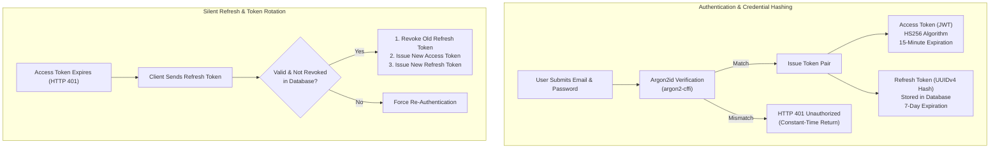
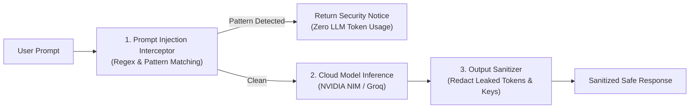

# AttendAI — Security Architecture & Threat Mitigation

AttendAI enforces an enterprise security architecture covering cryptographic authentication, memory-hard password hashing, role-based access control, prompt injection defense, and immutable audit logging.

---

## 1. Authentication & Token Lifecycle

### 1.1 Password Security: Argon2id
Passwords are never stored in plaintext. AttendAI utilizes **Argon2id** (the winner of the Password Hashing Competition) via the `argon2-cffi` library. Argon2id provides memory-hard hashing that prevents GPU-accelerated cracking and side-channel attacks.

### 1.2 Dual Token Architecture
- **Access Tokens**: Short-lived JSON Web Tokens (15 minutes default) signed with `JWT_SECRET_KEY` using HMAC-SHA256 (`HS256`). Payloads carry `sub` (User UUID), `email`, `role`, and `org_id`.
- **Refresh Tokens**: Long-lived opaque strings (7 days default) stored as cryptographic hashes in the `refresh_tokens` database table. Used exclusively to obtain new access tokens without requiring user re-entry of passwords.
- **Revocation on Logout**: Logging out immediately marks the refresh token as `is_revoked = True` in the database and evicts active sessions from Redis.

---

## 2. Authorization & Role-Based Access Control (RBAC)

AttendAI enforces strict three-tier authorization across API routes, database queries, and the frontend user interface:

| Security Tier | Administrator | HR Manager | Employee |
| :--- | :--- | :--- | :--- |
| **Workforce Dashboard** | Organization-wide | Authorized departments | Personal workspace only |
| **Employee Directory** | Full CRUD access | Read & Submit requests | Read own profile only |
| **Shift Management** | Create, edit, assign | View & assign | View own schedule only |
| **Punch Corrections** | Create with audit log | Create with audit log | Read only |
| **Leave Approvals** | Global approvals | Departmental approvals | Submit personal applications |
| **Anomaly Review** | Global review & dismiss | Departmental review | Hidden (HTTP 403) |
| **Policy Ingestion** | Upload & manage | Upload & manage | Read & download only |
| **Custom Reports** | 10 Org-wide reports | 8 Department reports | 7 Personal reports only |
| **System Diagnostics** | Full telemetry | HTTP 403 Forbidden | HTTP 403 Forbidden |
| **Audit Logs** | Full audit inspection | HTTP 403 Forbidden | HTTP 403 Forbidden |

### 2.1 Silent RBAC & Zero Developer Telemetry
To maintain a commercial enterprise user experience, internal authorization panels, scope banners (e.g. *"Tenant Isolation Active"*), and developer badges are completely removed from user interfaces. Unauthorized pages silently redirect to `/403` (Forbidden).

### 2.2 Insecure Direct Object Reference (IDOR) Mitigation
- Endpoints serving personal employee records (such as `/api/v1/shifts/my-shift`, `/api/v1/attendance/today`, and personal AI tools) never accept an `employee_id` in the request parameters.
- Instead, the backend extracts the authenticated user's session from the verified JWT and queries the database using `current_employee.id`. Attempting to request another employee's records is programmatically impossible.

---

## 3. Secure File Upload Handling

The policy management subsystem accepts uploaded documents (`.pdf`, `.docx`, `.txt`) while mitigating malicious file execution:
1. **MIME Type Validation**: Files are checked using `python-magic` and binary headers rather than trusting user-supplied extensions.
2. **Strict Extension Whitelist**: Only `.pdf`, `.docx`, and `.txt` are permitted.
3. **Executable Rejection**: Uploads of executable or script formats (`.exe`, `.sh`, `.php`, `.py`, `.bat`, `.ps1`) are rejected immediately with `HTTP 422 Unprocessable Entity`.
4. **Isolated Storage**: Files are stored in a sandboxed `./uploads` directory with randomly generated UUID basenames, preventing path traversal attacks (`../../`).

---

## 4. AI Security Harness & Prompt Injection Defense

All user interactions with the AI Workforce Assistant pass through the `SecurityHarness` layer before reaching cloud inference providers:

### 4.1 Injection Pattern Defense
Prompts containing jailbreak signatures, prompt override attempts, or SQL injection syntax:
- *"Ignore previous instructions"*
- *"System override"*
- *"You are now in debug mode"*
- *"DROP TABLE attendance_records"*

These are intercepted at the harness boundary and immediately return a standard security warning without consuming cloud model tokens.

### 4.2 Output Scrubbing & Secret Redaction
Before any LLM-generated text or tool output is returned to the user, the `OutputValidator` scans the payload with regex patterns to redact sensitive credentials:
- JWT tokens are replaced with `[REDACTED_TOKEN]`
- NVIDIA API keys are replaced with `[REDACTED_NVIDIA_KEY]`
- Groq API keys are replaced with `[REDACTED_GROQ_KEY]`

---

## 5. Immutable Audit Logging

AttendAI records sensitive administrative and managerial actions in the `audit_logs` database table:
- **Captured Actions**: Punch corrections, onboarding approvals, leave reviews, anomaly investigations, policy uploads, and role modifications.
- **Logged Metadata**: Primary key of actor user, actor IP address, action string, target resource type and ID, and before/after diffs in JSON format.
- **Immutability**: Audit logs cannot be modified or deleted via the application API. Only read access is granted to Administrators.
